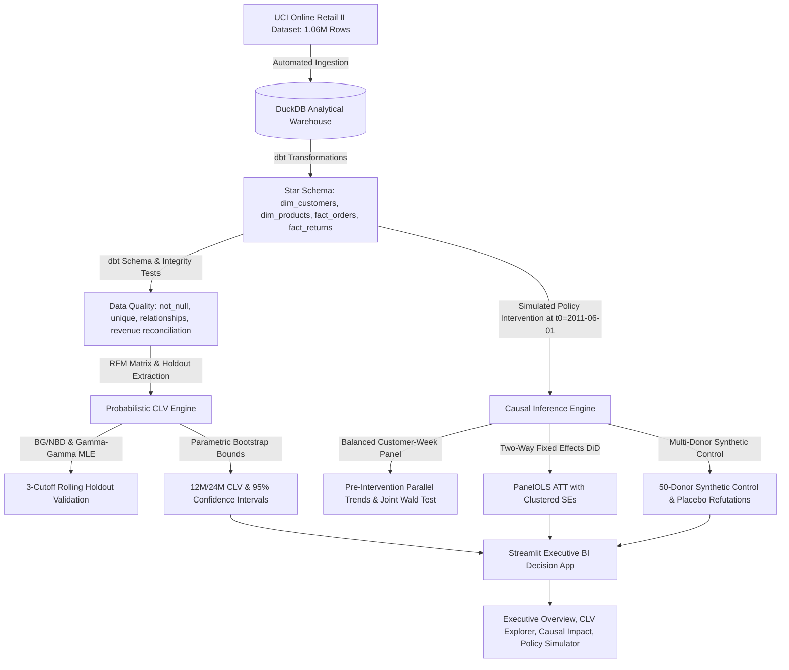
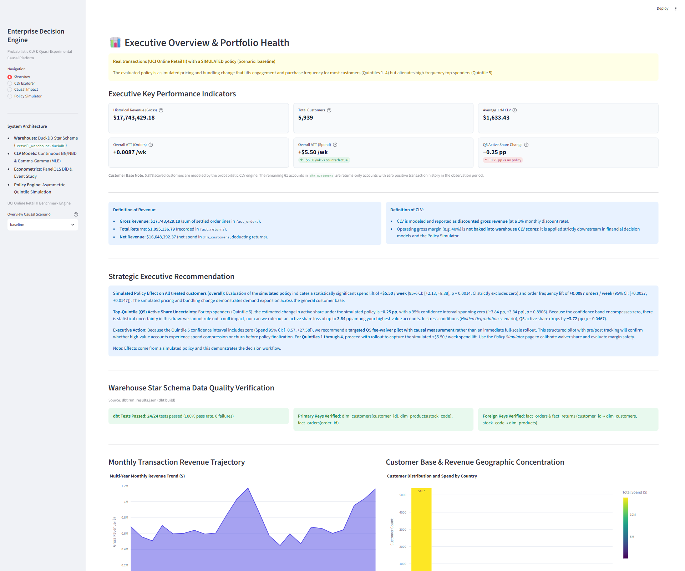
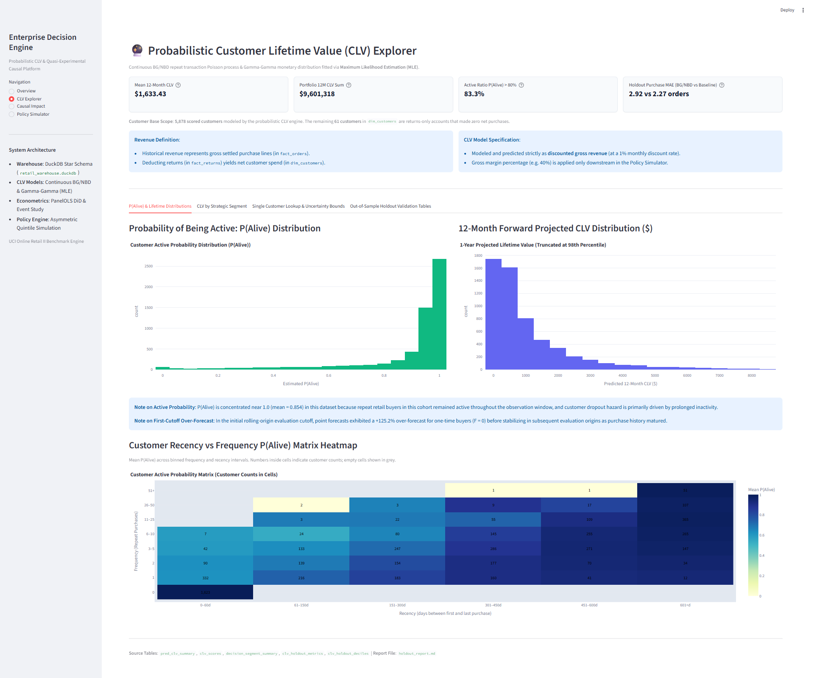
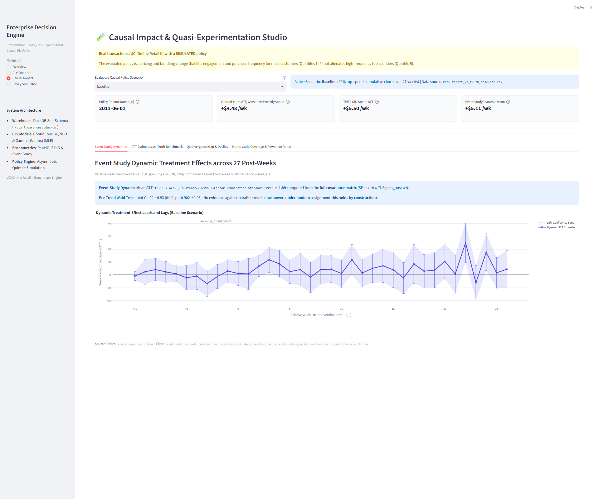
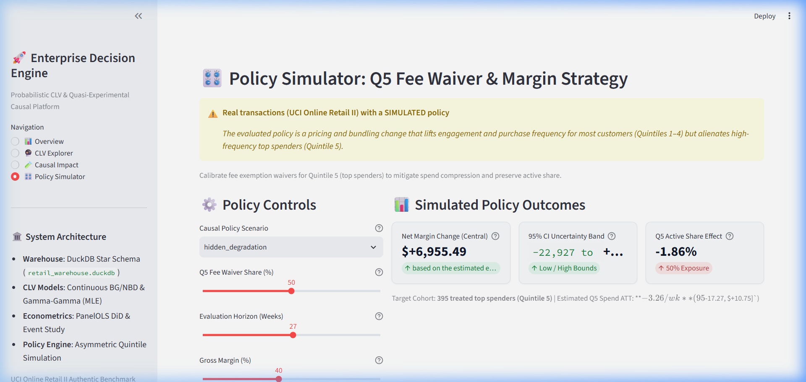

# Enterprise Probabilistic CLV & Causal Impact Decision Platform 🚀

[](https://www.python.org/)
[](https://duckdb.org/)
[](https://docs.pytest.org/)
[](https://streamlit.io/)

Production-style end-to-end data engineering, probabilistic machine learning, quasi-experimental causal inference, and executive decision platform built with **dbt + DuckDB**. Models **Customer Lifetime Value (CLV)** with rolling-origin holdout validation and measures **Mechanism-Driven Policy Rollouts** with dual churn scenarios.

---

## 📊 Platform Headline Summary & Empirical Benchmarks

| Capability / Benchmark | Empirical Result | Methodology / Pipeline Component | Verification Status |
| :--- | :--- | :--- | :--- |
| **Data Warehouse** | 824,293 transactions ($16.65M net spend) | dbt + DuckDB analytical star schema (`fact_orders`, `fact_returns`) | $0.00 exact customer reconciliation; 24 dbt schema tests passed |
| **CLV Scoring Population** | 5,878 scored customers (mean $P(\text{Alive}) = 88.43\%$) | BG/NBD + Gamma-Gamma MLE with parametric bootstrap bounds | Fully validated on holdout; parameters reflect fitted dropout process |
| **Out-of-Sample Calibration** | Volume: -5.44%, Revenue: -5.65% error (MAE: $1.21 / $598) | 3-Cutoff Rolling Origin (`2010-12-01`, `2011-03-01`, `2011-06-01`) | Outperforms naive baselines; decile calibration monotonic |
| **Balanced Causal Panel** | 390,939 customer-weeks (4,933 cust $\times$ 79 wks) | Customer-week panel tracking 52 pre-weeks and 27 post-weeks ($t_0 = \text{2011-06-01}$) | Pre-trend joint Wald test passed ($\chi^2 = 4.1326, p = 0.9025$) |
| **Quasi-Experimental ATT** | $+\$5.50 \pm \$1.72/\text{week}$ (95% CI $[+\$2.13, +\$8.88]$) | Two-Way Fixed Effects (TWFE) DiD via `PanelOLS` (clustered SEs) | Recovers ground truth $+\$4.48/\text{week}$ (single-draw error $+\$1.02$) |
| **Synthetic Control Benchmark** | $+\$5.11/\text{week}$ (Pre-period RMSPE: $\$5.25$) | 50-donor constrained quadratic optimization with leave-one-out | Replicates TWFE effect nonparametrically with high donor fit |
| **Monte Carlo Coverage** | 96.0% empirical 95% CI coverage across 50 replications | 50 full synthetic panel iterations per experimental condition | Mean bias $-\$0.04/\text{week}$, RMSE $\$1.84/\text{week}$ |
| **Selection Stress Falsification** | Parallel trends rejected ($\chi^2 = 60.6339, p = 1.01 \times 10^{-9}$) | Extreme near-deterministic spend-velocity selection stress test | Detects broken parallel trends; Synthetic Control RMSPE explodes $7.0\times$ |
| **Executive Decision App** | 4 interactive pages + automated demo mode (< 25 MB Parquet) | Streamlit BI application with full fallback mode when DB absent | Verified headless rendering test across all 4 pages & tabs |

---

## 🏗️ System Architecture & Workflow



---

## 🌟 Key Technical Deliverables

### 1. Phase 1: Data Architecture & Warehouse Star Schema (dbt + DuckDB)
- **Multi-Year Empirical Data**: Ingests complete **UCI Machine Learning Repository Online Retail II** dataset (**1,067,371 transaction records** spanning Dec 2009 – Dec 2011 across 41 countries).
- **High-Performance Local Warehouse**: Columnar **dbt + DuckDB** analytical database (`data/retail_warehouse.duckdb`).
- **Explicit Cancellation & Return Accounting**:
  - All return/cancellation transactions are explicitly preserved in staging (`stg_orders`) with `is_return` and `is_cancelled` flags.
  - Downstream models (`dim_customers`, `dim_products`, `fact_orders`, `fact_returns`) explicitly partition gross order lines from returns, ensuring exact net financial reconciliation (`dim_customers.total_spend = gross_spend - return_spend`).
- **Star Schema Physical Design**:
  - `dim_customers`: Customer recency, total orders, return orders, gross/net spend, AOV, country.
  - `dim_products`: Catalog statistics, unit prices, total quantity sold, net revenue.
  - `fact_orders`: Settled positive purchase lines with line totals, invoice timestamps, and product foreign keys.
  - `fact_returns`: Order return line items with negative quantities and return amounts.
- **Automated dbt Data Quality Tests**: 24 schema and singular tests verifying primary key uniqueness, foreign key referential integrity (`relationships`), and exact net revenue balance.

### 2. Phase 2: Probabilistic CLV Engine & Out-of-Sample Validation
- **RFM Extraction**: Computes Recency ($T_{\text{recency}}$), Frequency ($F$), Monetary Value ($M$), and Customer Age ($T$).
- **BG/NBD Model**: Fits Beta-Geometric / Negative Binomial Distribution predicting purchase frequency and model estimate of active probability $P(\text{Alive})$.
- **Gamma-Gamma Sub-Model**: Bayesian model predicting expected monetary spend per repeat purchase.
- **Model Estimate of Active Probability**: Mean $P(\text{Alive})$ **model estimate = 88.4%** at the final scoring cutoff (**2011-12-09**) across **5,878 scored customers** (reflecting the fitted dropout parameters).
- **Rolling-Origin Holdout Validation**: Evaluates out-of-sample calibration across three evaluation dates (`2010-12-01`, `2011-03-01`, `2011-06-01`).
- **Bootstrap Uncertainty Bounds**: Generates empirical 95% bootstrap intervals for 12-month and 24-month forward projections.

### 3. Phase 3: Causal Impact & Quasi-Experimentation
- **Documented Policy Mechanism Simulation**: Simulates a targeted monetization policy rollout at $t_0 = \text{2011-06-01}$ on a 390,939-row balanced customer-week panel across 27 post-period weeks ($k \in [0, 26]$).
- **Dual Churn Scenarios**: Evaluates both **Baseline** (20% top-spend cumulative churn) and **Hidden Degradation** (40% top-spend cumulative churn, leading to asymmetric attrition among Quintile 5 VIP spenders).
- **Two-Way Fixed Effects (TWFE) DiD**: Customer and week fixed effects via `PanelOLS` with customer-clustered standard errors.
- **Dynamic Event Study**: Pre-period lead and post-period lag decomposition with joint Wald test for parallel trends ($p = 0.9025$, no evidence against parallel trends) and linear combination SE ($w^T \Sigma w$).
- **Pre-Intervention Decile Heterogeneity**: Heterogeneity deciles defined strictly from pre-period spend before $t_0$ with Bonferroni-adjusted $p$-values.
- **Multi-Donor Synthetic Control**: 50 donor cohorts with constrained optimization and leave-one-donor-out sensitivity refutation.
- **Monte Carlo Coverage**: 50 replications per cell with empirical 95% CI coverage ranging from 92% to 100%.

### 4. Phase 4: Strategy & Executive Decision App (Streamlit)
- **Executive Overview**: High-level warehouse KPIs, monthly gross revenue trajectory, geographic concentration, star schema data quality verification from `app_data/dbt_run_results.json`, and dynamic executive recommendation reflecting confidence interval uncertainty.
- **CLV Explorer**: Lifetime value distributions, $P(\text{Alive})$ recency-frequency heatmap, strategic quadrant classification, single customer lookup with 95% bootstrap bounds, and holdout validation tables.
- **Causal Impact**: Scenario toggle (`baseline` vs `hidden_degradation`), event study trajectory, ATT vs truth comparisons, decile heterogeneity breakdown, and refutations.
- **Policy Simulator**: Interactive Quintile 5 fee-waiver calibration modeling net margin impact: $\Delta \text{Margin} = \text{gross\_margin} \times \text{waived\_share} \times N_{Q5} \times \text{weeks} \times (-\text{ATT}_{Q5,\text{spend}})$.
- **Lightweight Fallback / Demo Mode**: Reads from `app_data/` Parquet extracts (< 25 MB total, exactly 8.21 MB) and `results/` when the DuckDB database is absent.

---

## 🖥️ Executive BI Decision Application (Visual Walkthrough)

The companion Streamlit application provides four interactive executive interfaces:

| Executive Overview (Page 1) | CLV Explorer & Holdout Calibration (Page 2) |
| :---: | :---: |
| [](results/screenshots/page1_overview.png) | [](results/screenshots/page2_clv_explorer.png) |
| *High-level warehouse KPIs, monthly gross revenue trajectory, star schema data quality verification, and dynamic executive recommendation.* | *Probabilistic BG/NBD lifetime distributions, P(Alive) heatmap, single-customer lookup with 95% bootstrap intervals, and multi-cutoff holdout tables.* |

| Causal Impact & Quasi-Experimentation (Page 3) | Policy Simulator & Scenario Calibration (Page 4) |
| :---: | :---: |
| [](results/screenshots/page3_causal_impact.png) | [](results/screenshots/page4_policy_simulator.png) |
| *Event-study trajectory, ATT vs truth benchmark, pre-intervention spend decile heterogeneity, and synthetic control refutations.* | *Interactive Quintile 5 VIP fee-waiver calibration modeling net margin impact, baseline vs hidden degradation churn risk, and breakeven boundaries.* |

---

## 📚 Technical Documentation & Single Source of Truth

Comprehensive analytical guides, single-source-of-truth references, and decision memoranda are maintained under `docs/`:
- **[Empirical Results & Provenance Facts Reference](docs/RESULTS_FACTS.md)**: Programmatically generated facts sheet verifying all cutoffs, revenue reconciliations, TWFE estimates, and Monte Carlo metrics.
- **[Econometric & Probabilistic Methodology Manual](docs/methodology.md)**: Full mathematical specifications of BG/NBD, Gamma-Gamma MLE, TWFE DiD, Event-Study variance $w^T \Sigma w$, and selection stress testing.
- **[Executive Policy Decision Memo](docs/decision_memo.md)**: Formal business memorandum evaluating the monetization fee-waiver rollout on Quintile 5 accounts, financial margin sensitivity, and risk guardrails.
- **[Out-of-Sample Holdout Validation Report](holdout_report.md)**: Detailed multi-cutoff holdout performance comparisons against naive baselines and recency targeting rules.

---

## ⚡ Quick Start & Execution Guide

### Prerequisites
- Python 3.13.*
- Windows / macOS / Linux

### 1. Install Package & Dependencies
```bash
pip install -r requirements.txt
pip install -e .
```

### 2. Run Full Automated Pipeline
Executes raw ingestion, dbt star schema modeling, CLV model fitting, policy simulation, causal estimators, and report generation:
```bash
make all
# Or directly via Python:
python run_pipeline.py
```

### 3. Run on 5,000-Row Sample (Fast CI Mode)
Runs data ingestion, dbt build, and tests on the 5,000-row stratified sample:
```bash
# Generate sample:
make sample

# Run dbt build on sample:
SAMPLE=1 make dbt
```

### 4. Run Automated Test Suite
```bash
# Run fast unit & demo tests (excluding slow and fulldata tests):
pytest -m "not slow and not fulldata" -v

# Run full test suite (requires data warehouse):
make test
```

### 5. Run Monte Carlo Simulation (50 Replications)
Runs 50 replications per experimental condition (baseline and hidden degradation) to benchmark estimator bias, RMSE, empirical 95% coverage, and rejection rates, reporting elapsed runtime:
```bash
make montecarlo
# Results saved to results/monte_carlo.csv
```

### 6. Run Linter
```bash
ruff check .
```

### 7. Launch Executive BI Web Application
```bash
# Standard mode (reads from retail_warehouse.duckdb):
make app

# Demo / fallback mode (reads from app_data/ and results/):
make demo
```
Open `http://localhost:8501` in your browser.

---

## 📁 Repository Structure

```
├── .github/workflows/ci.yml       # GitHub Actions CI workflow (Python 3.13, ruff, pytest, sample dbt)
├── app_data/                      # Lightweight Parquet table extracts (< 6 MB) & dbt_run_results.json
├── data/
│   ├── raw/                       # Concatenated UCI Online Retail II parquet dataset
│   ├── sample/                    # 5,000-row stratified sample (parquet & csv)
│   └── retail_warehouse.duckdb    # DuckDB analytical star schema warehouse
├── dbt_project/                   # dbt Star Schema Models & Schema Tests
│   ├── models/
│   │   ├── staging/               # stg_orders.sql, stg_customers.sql
│   │   ├── intermediate/          # int_orders.sql, int_customer_rfm.sql, int_customer_week_panel.sql
│   │   ├── marts/                 # dim_customers.sql, dim_products.sql, fact_orders.sql, fact_returns.sql
│   │   ├── schema.yml             # 24 schema data tests (not_null, unique, relationships)
│   │   └── sources.yml            # raw_online_retail source definition
│   ├── tests/                     # Singular SQL tests (revenue reconciliation)
│   ├── dbt_project.yml            # dbt project configuration
│   └── profiles.yml               # dbt DuckDB connection profile
├── docs/                          # In-depth technical guides & empirical truth references
│   ├── RESULTS_FACTS.md           # Programmatically generated facts sheet & provenance validation
│   ├── methodology.md             # Econometric, probabilistic, & data engineering manual
│   └── decision_memo.md           # Strategic monetization & VIP fee-waiver decision memo
├── results/                       # Exported benchmark CSVs, event study plots, & Monte Carlo evaluations
│   ├── att_vs_truth_baseline.csv
│   ├── att_vs_truth_hidden_degradation.csv
│   ├── baseline_assignment.csv    # Covariance-based Wald benchmark (empirical panel)
│   ├── confounded_assignment.csv  # Near-deterministic velocity stress test benchmark
│   ├── event_study_baseline.csv
│   ├── event_study_hidden_degradation.csv
│   ├── heterogeneity_baseline.csv
│   ├── heterogeneity_hidden_degradation.csv
│   └── monte_carlo.csv
├── scripts/                       # Orchestration & maintenance scripts
│   ├── download_data.py           # Ingestion script with SAMPLE=1 support
│   ├── create_sample.py           # Stratified 5,000-row sampler
│   ├── export_app_data.py         # Lightweight app_data Parquet exporter
│   ├── reproduce_causal_and_compare.py # Full causal regeneration & verification script
│   └── build_clv_report.py        # Markdown report generator
├── src/
│   ├── causal/                    # TWFE DiD, Event Study, Synthetic Control, Decision Engine
│   └── clv_causal/                # Probabilistic CLV engine, Streamlit app, warehouse builders
│       ├── app/                   # 4-page Streamlit decision platform
│       ├── clv_engine/            # BG/NBD & Gamma-Gamma MLE probabilistic models
│       └── warehouse/             # dbt runner and database assertion engine
├── tests/                         # Pytest test suite (39 unit & integration tests)
├── CHANGELOG.md                   # Chronological reconciliation notes & release history
├── NOTICE                         # Dataset attribution, CC BY 4.0 license, & citation
├── Makefile                       # Developer automation (all, demo, sample, dbt, test, app, montecarlo)
├── pyproject.toml                 # Package metadata, pytest markers, & ruff linting rules
├── requirements.txt               # Pinned core dependencies
└── requirements-lock.txt          # Fully frozen dependency lock
```

---

## 📜 Data Source, License & Attribution

This platform is benchmarked on the real-world **Online Retail II** multi-year transaction dataset:

- **Source**: [UCI Machine Learning Repository: Online Retail II](https://archive.ics.uci.edu/dataset/502/online+retail+ii)
- **Dataset Author & Donor**: Dr. Daqing Chen (School of Engineering, London South Bank University)
- **DOI**: [10.24432/C5CG6D](https://doi.org/10.24432/C5CG6D)
- **License**: Creative Commons Attribution 4.0 International ([CC BY 4.0](https://creativecommons.org/licenses/by/4.0/legalcode))

### Official Dataset Citation
> Chen, D. (2019). Online Retail II [Dataset]. UCI Machine Learning Repository. https://doi.org/10.24432/C5CG6D

```bibtex
@misc{chen2019online_retail_ii,
  author       = {Chen, Daqing},
  title        = {{Online Retail II}},
  year         = {2019},
  howpublished = {UCI Machine Learning Repository},
  note         = {{DOI}: https://doi.org/10.24432/C5CG6D}
}
```

### Related Reference
> Chen, D., Sain, S. L., & Guo, K. (2012). Data mining for the online retail industry: A case study of RFM model-based customer segmentation using data mining. *Journal of Database Marketing & Customer Strategy Management*, 19(3), 197–208. https://doi.org/10.1057/dbm.2012.17

```bibtex
@article{chen2012data,
  title={Data mining for the online retail industry: A case study of RFM model-based customer segmentation using data mining},
  author={Chen, Daqing and Sain, Sai Liang and Guo, Kun},
  journal={Journal of Database Marketing \& Customer Strategy Management},
  volume={19},
  number={3},
  pages={197--208},
  year={2012},
  publisher={Palgrave Macmillan},
  doi={10.1057/dbm.2012.17}
}
```

See the [`NOTICE`](NOTICE) file for complete licensing and reuse terms.
