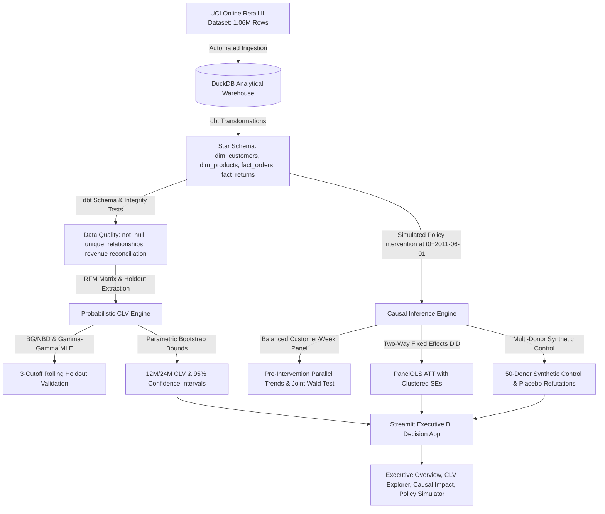

# Enterprise Probabilistic CLV & Causal Impact Decision Platform 🚀

[](https://www.python.org/)
[](https://duckdb.org/)
[](https://docs.pytest.org/)
[](https://streamlit.io/)

Production-style end-to-end data engineering, probabilistic machine learning, quasi-experimental causal inference, and executive decision platform built with **dbt + DuckDB**. Models **Customer Lifetime Value (CLV)** with rolling-origin holdout validation and measures **Mechanism-Driven Policy Rollouts** with dual churn scenarios.

---

## 🏗️ System Architecture & Workflow



---

## 🌟 Key Technical Deliverables

### 1. Phase 1: Data Architecture & Warehouse Star Schema (dbt + DuckDB)
- **Multi-Year Empirical Data**: Ingests complete **UCI Machine Learning Repository Online Retail II** dataset (**1,067,371 transaction records** spanning Dec 2009 – Dec 2011 across 41 countries).
- **High-Performance Local Warehouse**: Columnar **dbt + DuckDB** analytical database (`data/retail_warehouse.duckdb`).
- **Explicit Cancellation & Return Accounting**:
  - All return/cancellation transactions are explicitly preserved in staging (`stg_orders`) with `is_return` and `is_cancelled` flags.
  - Downstream models (`dim_customers`, `dim_products`, `fact_orders`, `fact_returns`) explicitly partition gross order lines from returns, ensuring exact net financial reconciliation (`dim_customers.total_spend = gross_spend - return_spend`).
- **Star Schema Physical Design**:
  - `dim_customers`: Customer recency, total orders, return orders, gross/net spend, AOV, country.
  - `dim_products`: Catalog statistics, unit prices, total quantity sold, net revenue.
  - `fact_orders`: Settled positive purchase lines with line totals, invoice timestamps, and product foreign keys.
  - `fact_returns`: Order return line items with negative quantities and return amounts.
- **Automated dbt Data Quality Tests**: 24 schema and singular tests verifying primary key uniqueness, foreign key referential integrity (`relationships`), and exact net revenue balance.

### 2. Phase 2: Probabilistic CLV Engine & Out-of-Sample Validation
- **RFM Extraction**: Computes Recency ($T_{\text{recency}}$), Frequency ($F$), Monetary Value ($M$), and Customer Age ($T$).
- **BG/NBD Model**: Fits Beta-Geometric / Negative Binomial Distribution predicting purchase frequency and model estimate of active probability $P(\text{Alive})$.
- **Gamma-Gamma Sub-Model**: Bayesian model predicting expected monetary spend per repeat purchase.
- **Model Estimate of Active Probability**: Mean $P(\text{Alive})$ **model estimate = 88.4%** at the final scoring cutoff (**2011-12-09**) across **5,878 scored customers** (reflecting the fitted dropout parameters; an earlier 0.854 figure originated from an intermediate rolling-origin evaluation cutoff).
- **Rolling-Origin Holdout Validation**: Evaluates out-of-sample calibration across three evaluation dates (`2010-12-01`, `2011-03-01`, `2011-06-01`).
- **Bootstrap Uncertainty Bounds**: Generates empirical 95% bootstrap intervals for 12-month and 24-month forward projections.

### 3. Phase 3: Causal Impact & Quasi-Experimentation
- **Documented Policy Mechanism Simulation**: Simulates a targeted monetization policy rollout at $t_0 = \text{2011-06-01}$ on a 390,939-row balanced customer-week panel across 27 post-period weeks ($k \in [0, 26]$).
- **Dual Churn Scenarios**: Evaluates both **Baseline** (20% top-spend cumulative churn) and **Hidden Degradation** (40% top-spend cumulative churn, leading to asymmetric attrition among Quintile 5 VIP spenders).
- **Two-Way Fixed Effects (TWFE) DiD**: Customer and week fixed effects via `PanelOLS` with customer-clustered standard errors.
- **Dynamic Event Study**: Pre-period lead and post-period lag decomposition with joint Wald test for parallel trends ($p = 0.9025$, no evidence against parallel trends) and linear combination SE ($w^T \Sigma w$).
- **Pre-Intervention Decile Heterogeneity**: Heterogeneity deciles defined strictly from pre-period spend before $t_0$ with Bonferroni-adjusted $p$-values.
- **Multi-Donor Synthetic Control**: 50 donor cohorts with constrained optimization and leave-one-donor-out sensitivity refutation.
- **Monte Carlo Coverage**: 50 replications per cell with empirical 95% CI coverage ranging from 92% to 100%.

### 4. Phase 4: Strategy & Executive Decision App (Streamlit)
- **Executive Overview**: High-level warehouse KPIs, monthly gross revenue trajectory, geographic concentration, star schema data quality verification from `app_data/dbt_run_results.json`, and dynamic executive recommendation reflecting confidence interval uncertainty.
- **CLV Explorer**: Lifetime value distributions, $P(\text{Alive})$ recency-frequency heatmap, strategic quadrant classification, single customer lookup with 95% bootstrap bounds, and holdout validation tables.
- **Causal Impact**: Scenario toggle (`baseline` vs `hidden_degradation`), event study trajectory, ATT vs truth comparisons, decile heterogeneity breakdown, and refutations.
- **Policy Simulator**: Interactive Quintile 5 fee-waiver calibration modeling net margin impact: $\Delta \text{Margin} = \text{gross\_margin} \times \text{waived\_share} \times N_{Q5} \times \text{weeks} \times (-\text{ATT}_{Q5,\text{spend}})$.
- **Lightweight Fallback / Demo Mode**: Reads from `app_data/` Parquet extracts (< 6 MB total) and `results/` when the DuckDB database is absent.

---

## ⚡ Quick Start & Execution Guide

### Prerequisites
- Python 3.13.*
- Windows / macOS / Linux

### 1. Install Package & Dependencies
```bash
pip install -r requirements.txt
pip install -e .
```

### 2. Run Full Automated Pipeline
Executes raw ingestion, dbt star schema modeling, CLV model fitting, policy simulation, causal estimators, and report generation:
```bash
make all
# Or directly via Python:
python run_pipeline.py
```

### 3. Run on 5,000-Row Sample (Fast CI Mode)
Runs data ingestion, dbt build, and tests on the 5,000-row stratified sample:
```bash
# Generate sample:
make sample

# Run dbt build on sample:
SAMPLE=1 make dbt
```

### 4. Run Automated Test Suite
```bash
# Run all tests:
make test

# Run fast tests (skipping slow causal evaluation export):
pytest -m "not slow" -v
```

### 5. Run Linter
```bash
ruff check .
```

### 6. Launch Executive BI Web Application
```bash
# Standard mode (reads from retail_warehouse.duckdb):
make app

# Demo / fallback mode (reads from app_data/ and results/):
make demo
```
Open `http://localhost:8501` in your browser.

---

## 📁 Repository Structure

```
├── .github/workflows/ci.yml       # GitHub Actions CI workflow (Python 3.13, ruff, pytest, sample dbt)
├── app_data/                      # Lightweight Parquet table extracts (< 6 MB) & dbt_run_results.json
├── data/
│   ├── raw/                       # Concatenated UCI Online Retail II parquet dataset
│   ├── sample/                    # 5,000-row stratified sample (parquet & csv)
│   └── retail_warehouse.duckdb    # DuckDB analytical star schema warehouse
├── dbt_project/                   # dbt Star Schema Models & Schema Tests
│   ├── models/
│   │   ├── staging/               # stg_orders.sql, stg_customers.sql
│   │   ├── intermediate/          # int_orders.sql, int_customer_rfm.sql, int_customer_week_panel.sql
│   │   ├── marts/                 # dim_customers.sql, dim_products.sql, fact_orders.sql, fact_returns.sql
│   │   ├── schema.yml             # 24 schema data tests (not_null, unique, relationships)
│   │   └── sources.yml            # raw_online_retail source definition
│   ├── tests/                     # Singular SQL tests (revenue reconciliation)
│   ├── dbt_project.yml            # dbt project configuration
│   └── profiles.yml               # dbt DuckDB connection profile
├── results/                       # Exported benchmark CSVs, event study plots, & Monte Carlo evaluations
│   ├── att_vs_truth_baseline.csv
│   ├── att_vs_truth_hidden_degradation.csv
│   ├── event_study_baseline.csv
│   ├── event_study_hidden_degradation.csv
│   ├── heterogeneity_baseline.csv
│   ├── heterogeneity_hidden_degradation.csv
│   └── monte_carlo.csv
├── scripts/                       # Orchestration & maintenance scripts
│   ├── download_data.py           # Ingestion script with SAMPLE=1 support
│   ├── create_sample.py           # Stratified 5,000-row sampler
│   ├── export_app_data.py         # Lightweight app_data Parquet exporter
│   ├── reproduce_causal_and_compare.py # Full causal regeneration & verification script
│   └── build_clv_report.py        # Markdown report generator
├── src/
│   ├── causal/                    # TWFE DiD, Event Study, Synthetic Control, Decision Engine
│   └── clv_causal/                # Probabilistic CLV engine, Streamlit app, warehouse builders
│       ├── app/                   # 4-page Streamlit decision platform
│       ├── clv_engine/            # BG/NBD & Gamma-Gamma MLE probabilistic models
│       └── warehouse/             # dbt runner and database assertion engine
├── tests/                         # Pytest test suite (34 unit & integration tests)
├── Makefile                       # Developer automation (all, demo, sample, dbt, test, app)
├── pyproject.toml                 # Package metadata, pytest markers, & ruff linting rules
├── requirements.txt               # Pinned core dependencies
└── requirements-lock.txt          # Fully frozen dependency lock
```
