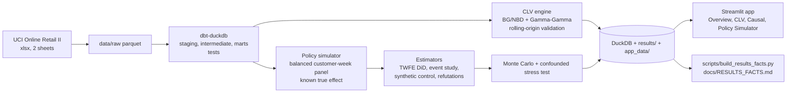

# Monetization Causal CLV Engine


An end-to-end analytics system that (1) models customer lifetime value on real retail transactions and (2) measures the **causal** effect of a pricing/bundling policy, including damage to high-value customers that revenue totals hide.

> **Read this first: the policy is simulated.**
> The transactions are real (UCI Online Retail II, 2009-12-01 to 2011-12-09). The pricing policy is **injected by a simulator** at 2011-06-01 with a *known* true effect. That is deliberate: it lets the project check whether each estimator recovers the truth, which a real policy never allows. No claim in this repository is about the real company's pricing.

---

## Headline results

| Question | Answer (all numbers from `docs/RESULTS_FACTS.md`, generated from files in `results/`) |
|---|---|
| Can the CLV model forecast purchases? | It **ranks** customers well but **over-forecasts volume** early: +46.9% purchases at the first cutoff (2010-12-01), +7.9% at the second, -5.4% at the third. A one-line carry-forward baseline has lower error at the first cutoff (purchases MAE 2.27 vs 2.92). |
| Do the causal estimators recover a planted effect? | Yes. Two-way fixed-effects DiD: **18 of 18** single-run 95% intervals cover the true effect; across 50 Monte Carlo replications per scenario coverage is 92-100%. |
| Can a policy look fine in aggregate while hurting top customers? | Yes. In the `hidden_degradation` scenario the overall spend effect is +$1.66/customer-week (95% CI -1.71 to +5.03, not significant), while the top-spend quintile loses **3.7 pp** of its active share (95% CI -7.38 to -0.05). |
| Which outcome detects the damage? | Active share, not revenue. For the top quintile the Monte Carlo rejection rate is **70%** for active share, 48% for orders and **14%** for spend. |
| Do the diagnostics fire when assumptions fail? | Yes. Under deliberately confounded assignment the pre-trend Wald test rejects (chi2 = 60.6 vs 4.1 under random assignment), TWFE is biased by +$9.31 (+195%), and the synthetic-control pre-period error rises from $5.25 to $36.59. |

---

## Screenshots

| | |
|---|---|
|  |  |
|  |  |

**Live demo:** [https://monetization-causal-clv-engine.streamlit.app](https://monetization-causal-clv-engine.streamlit.app)

---

## Architecture



Models write their outputs back as tables and files; the app only reads them. Nothing heavy runs when a user clicks.

---

## Data

- **Source:** UCI Online Retail II, a UK online gift-ware retailer (many wholesale customers).
- **Size:** 1,067,371 raw rows; after cleaning, 805,549 positive order lines and 18,744 return lines linked to **5,939 customers** (5,878 scored; 61 have returns only).
- **Revenue:** gross $17,743,429.18, returns $1,095,136.79, net $16,648,292.39 (customer layer: $16,648,292.37).
- Returns are kept as their own table and reported separately, not silently dropped.

---

## CLV validation (rolling origin)

Calibration data ends at each cutoff; the holdout runs to 2011-12-09. BG/NBD and Gamma-Gamma are fit by maximum likelihood (no penalizer).

| Cutoff | Customers | Holdout days | Purchases (actual vs predicted) | Revenue (actual vs predicted) |
|---|---|---|---|---|
| 2010-12-01 | 4,266 | 373 | 14,365 vs 21,107 (+46.9%) | $7.43M vs $10.44M (+40.6%) |
| 2011-03-01 | 4,537 | 283 | 11,787 vs 12,722 (+7.9%) | $5.88M vs $6.49M (+10.5%) |
| 2011-06-01 | 4,933 | 191 | 9,092 vs 8,597 (-5.4%) | $4.58M vs $4.32M (-5.7%) |

By segment (purchases, actual vs predicted): one-time buyers at the first cutoff 1,316 vs 2,964 (+125%), at the second +34.5%, at the third +2.7%; repeat buyers +39.0%, +5.4% and -6.2%.

**Model family does not matter here.** BG/NBD, MBG/NBD and Pareto/NBD give almost the same errors (purchases MAE at the first cutoff 2.92, 2.95 and 3.02), so the limit comes from the data (seasonality, behaviour that changes over time), not the model choice.

**Honest comparison with simple baselines (first cutoff):**

| Cohort | Metric | BG/NBD | Carry-forward | Verdict |
|---|---|---|---|---|
| All customers | Purchases MAE | 2.92 | 2.27 | baseline better |
| All customers | Spearman rank | 0.567 | 0.580 | about equal |
| All customers | Top-decile capture | 43.8% | 43.2% | about equal |
| One-time buyers | Spearman rank | 0.231 | 0.000 | BG/NBD ranks; baseline cannot |
| One-time buyers | Top-decile capture | 17.6% | 10.6% | BG/NBD ahead |

For one-time buyers BG/NBD's ranking is identical to ranking by tenure (newest first), so it adds no information beyond that rule. Across all customers the model ranks well (average actual purchases rise from 0.59 in the lowest decile to 14.7 in the highest) but predicts too many purchases in every decile.

---

## Causal results

Design: customers whose first order is before the policy date (4,933); 40% treated, assigned within spend quintiles; policy date 2011-06-01 (78 pre-weeks, 27 post-weeks); balanced customer-by-week panel of 390,939 rows. For most customers the policy lifts order rate by 15% and basket size by 10%. Top-quintile treated customers also churn: 20% cumulative over 27 weeks in `baseline`, 40% in `hidden_degradation`.

Single-run TWFE DiD, customer and week fixed effects, standard errors clustered by customer:

| Scenario | Cohort | Outcome | True effect | Estimate | 95% CI |
|---|---|---|---|---|---|
| baseline | All treated | Weekly spend ($) | +4.48 | +5.50 | [+2.13, +8.88] |
| baseline | All treated | Weekly orders | +0.0057 | +0.0087 | [+0.0027, +0.0147] |
| hidden_degradation | All treated | Weekly spend ($) | +1.13 | +1.66 | [-1.71, +5.03] |
| hidden_degradation | Q1-Q4 | Weekly spend ($) | +2.95 | +3.05 | [+1.65, +4.46] |
| hidden_degradation | Top quintile | Weekly spend ($) | -6.12 | -3.26 | [-17.27, +10.75] |
| hidden_degradation | Top quintile | Active share (last 90 days) | -0.0379 | -0.0372 | [-0.0738, -0.0005] |

The full tables for all cohorts and outcomes are in `docs/RESULTS_FACTS.md`.

**Monte Carlo (50 replications per scenario):** mean bias is close to zero in every cell. Top-quintile rejection rates in `hidden_degradation`: active share 70%, orders 48%, spend 14%. The single-run active-share result above (p = 0.047) is borderline.

**Robustness:** event study with leads and lags (post-period mean +$5.11, SE $1.89 from the full covariance matrix, against TWFE +$5.50); joint pre-trend Wald test (chi2 = 4.13, p = 0.90, "no evidence against parallel trends"; under random assignment this holds by construction); synthetic control with 50 donor cohorts (its pre-period error is about as large as the effect, so it cannot detect effects this small); placebo date and leave-one-donor-out checks; pre-period spend deciles with Bonferroni correction.

---

## Policy simulator

Q5 waiver, scenario `hidden_degradation`, 50% of top-quintile accounts waived, 27 weeks, 40% gross margin:

- Net margin change: **+$6,955 central, but the 95% band runs from -$22,927 to +$36,838.** The data cannot say whether a waiver pays for itself.
- Q5 active-share change: -3.72 pp without a waiver, -1.86 pp with a 50% waiver.
- Formula: gross margin x waived share x top-quintile customers x weeks x (-ATT of top-quintile spend). Projections beyond 27 weeks are flagged as extrapolation.
- **Executive Decision Memorandum:** [Decision Memo (October 20, 2026)](docs/decision_memo.md)

---

## What I found and fixed while validating

Each item below was found by testing the system against known answers, and the fix is covered by a test or a generated report.

1. **Silent NaN-to-zero.** With a small penalizer the fitted BG/NBD parameters made a+b below 1, the library's closed form returned NaN for one-time buyers, and `nan_to_num` turned it into **zero predicted purchases**. Fix: no penalizer (a+b > 1), explicit errors instead of silent conversion, and a validated numerical fallback (agrees with the closed form to about 1e-11 and with a Monte Carlo simulation).
2. **Broken baseline.** The first "naive" baseline counted each customer's first order, over-forecasting by 220% and making the model look good. Fix: repeat-order baseline plus a carry-forward baseline.
3. **Synthetic data in place of real data.** A cached fallback file with 150,000 rows had replaced the real dataset. Fix: the loader now refuses to fall back silently and loads both sheets of the Excel file.
4. **Wrong pre-trend test.** The first Wald statistic summed squared z-scores and ignored covariance between coefficients. Fix: full-covariance Wald test.
5. **Simulator design.** A sparse panel (purchase weeks only) could not represent new orders; a pre-period order rate that counted each first order was biased by tenure; a "20% churn" setting was applied weekly, not cumulatively. Fixes: balanced panel, shrunken first-order-excluded rate, cumulative churn converted to a weekly hazard.
6. **Look-ahead in heterogeneity deciles.** They used model scores fit on data past the policy date. Fix: observed pre-period spend only.
7. **A report quoting the wrong number.** The facts script once printed a synthetic unit test's statistic as the real result. Fix: it now reads only saved result files and checks their provenance.

---

## Limitations

- The policy and its effects are simulated; real pricing effects, interference between customers and demand shifts are not modelled.
- One retailer, one dataset, two years. Seasonality (the holiday peak) is not modelled by BG/NBD and affects the first cutoff most.
- BG/NBD does not beat the carry-forward baseline on volume or overall ranking here. P(alive) is concentrated near 1 (88.4% mean), reflecting the fitted dropout parameters, so it separates customers weakly at the first cutoff.
- Random assignment makes parallel trends hold by construction; the confounded test shows the diagnostics, but real data would need a credible design.
- Weekly spend is heavy-tailed; spend effects are the hardest to detect, and the top-quintile spend result in `hidden_degradation` has low power (14%).
- The 40% gross margin and the guardrail thresholds (-0.5 pp amber, -2.0 pp red) are assumptions in `config.yaml`.
- Monte Carlo uses 50 replications per scenario, so each coverage figure carries about +/-3 points of simulation error.
- AI coding assistance (Antigravity) was used during development. Every number here is produced by committed scripts and tests.

---

## Run it

Requires Python 3.13. Place the raw file at `data/online_retail_II.xlsx` (UCI link below).

```bash
git clone https://github.com/rishichouhan905-dotcom/monetization-causal-clv-engine.git
cd monetization-causal-clv-engine
pip install -r requirements.txt
pip install -e .
make all            # data, dbt, CLV, causal, report (about 3.6 minutes on a laptop)
make app            # Streamlit app on localhost:8501
make demo           # app from small extracts in app_data/, no database needed
make test           # full test suite (needs the warehouse)
pytest -m "not slow and not fulldata"   # the fast set that CI runs
make montecarlo     # 50 replications per scenario (about 6 minutes)
```

`make sample` creates a 5,000-row stratified sample, and `SAMPLE=1 make dbt` runs dbt on it, which is what CI uses. CI runs ruff, 13 fast tests and `dbt build` on the sample; 27 further tests need the full data. In total there are 40 tests.

## Repository layout

```
dbt_project/        staging, intermediate and mart models, tests
src/clv_causal/     warehouse build, CLV engine, Streamlit app
src/causal/         simulator, TWFE DiD, event study, synthetic control, Monte Carlo
scripts/            data download, sample creation, results-facts builder
results/            saved outputs, plots and app screenshots
app_data/           small extracts that let the app run without the database
docs/               methodology.md, decision_memo.md, RESULTS_FACTS.md
tests/              unit and integration tests
```

## Data source and license

Online Retail II [Dataset]. UCI Machine Learning Repository. https://doi.org/10.24432/C5CG6D. Author and donor: Daqing Chen. Licensed CC BY 4.0. Related paper: Chen, D., Sain, S.L. and Guo, K. (2012), "Data mining for the online retail industry: A case study of RFM model-based customer segmentation using data mining", *Journal of Database Marketing and Customer Strategy Management*, doi:10.1057/dbm.2012.17. See `NOTICE`.

## Author

Rishiraj Chouhan, https://github.com/rishichouhan905-dotcom
